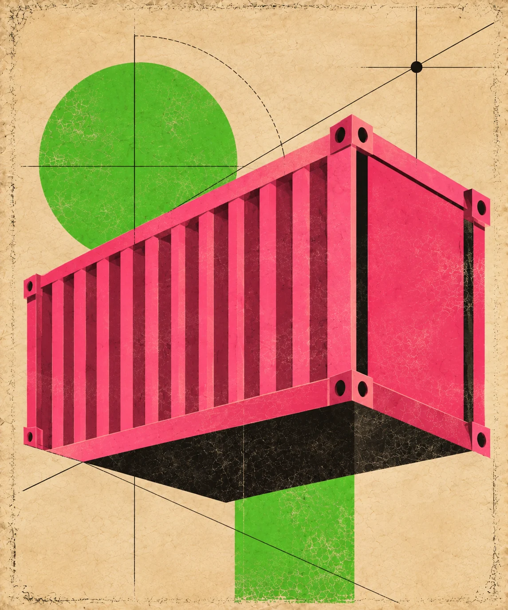

<p align="center">
  <picture>
    <source media="(prefers-color-scheme: dark)" srcset="docs/hero-dark.webp">
    
  </picture>
</p>

<div align="center">

# SFL Vue

**stickyflow.js in a Vue app, through one custom element.**

</div>

A model writes SFL, the page renders it, and your next message edits the same
diagram. It is the round trip from [sfl-chat](https://github.com/Stickyflow/sfl-chat),
rebuilt in Vue on top of `<stickyflow-diagram>` instead of the viewer API.
sfl-chat shows what full control looks like; this one shows the least setup
that works.

```text
prompt  →  /api/chat  →  reply with an SFL block  →  <stickyflow-diagram :source>
```

## Run it

```bash
cp .env.example .env    # an OpenAI key, an Anthropic key, or both
npm install
npm run dev
```

The keys stay in the Vite dev server and never reach the browser. With only
`ANTHROPIC_API_KEY` set, it runs on Claude.

The API is dev-server middleware, so this only works under `npm run dev`;
`npm run build` gives you static files and no backend. There is no auth and
no rate limiting, so keep it on localhost. `vite --host` hands your key's
spend to anyone on the network.

## The integration

Register the element once, before mounting (`src/main.ts`):

```ts
import { defineStickyflowDiagram } from 'stickyflow/web-component'

defineStickyflowDiagram()
```

Tell Vue's compiler it's a custom element, not a missing component
(`vite.config.ts`):

```ts
vue({
  template: {
    compilerOptions: {
      isCustomElement: (tag) => tag === 'stickyflow-diagram',
    },
  },
})
```

Bind it (`src/components/DiagramCard.vue`). `interactive` is a bare attribute
and turns on selection, pan and zoom:

```html
<stickyflow-diagram interactive :source="source" />
```

That's the whole integration. Everything else in `src/` is ordinary chat UI.

## Compared to sfl-chat

The gaps come from what the web component exposes, not from cutting corners.

| | sfl-chat | here |
| --- | --- | --- |
| Rendering | `stickyflow/viewer` | `<stickyflow-diagram>` |
| Drag, resize, edit labels | yes, via `stickyflow/interaction` | no, the element doesn't wire that tier in |
| Rejects a reply drawn on top of the old diagram | yes | no, only byte-identical replies are skipped |
| Model and provider | Settings dialog, per browser | `.env` only |
| Chats | many, kept in localStorage | one, in memory |

Shared with sfl-chat: the SFL primer, the OpenAI/Anthropic routing, one
diagram per chat, and sanitized markdown in replies. The code is copied, not
imported, so each repo stands on its own.

## Configuration

| `.env` | Default | |
| --- | --- | --- |
| `OPENAI_API_KEY`, `ANTHROPIC_API_KEY` | | Either one is enough. |
| `LLM_PROVIDER` | from the keys | `openai` or `anthropic`. Unset, it's Claude when only the Anthropic key is set, OpenAI otherwise. |
| `OPENAI_MODEL` | `gpt-5.6-sol` | |
| `ANTHROPIC_MODEL` | `claude-opus-5` | |
| `OPENAI_BASE_URL`, `ANTHROPIC_BASE_URL` | SDK default | Any compatible endpoint. |
| `OPENAI_REASONING_EFFORT`, `ANTHROPIC_EFFORT` | off | See `.env.example` before turning it on. |

Restart the dev server after changing `.env`.

## Layout

| Path | |
| --- | --- |
| `server/chatApi.ts` | The Vite plugin: `/api/chat`, `/api/config`, `/api/prompt`. |
| `server/request.ts` | Reads and validates the request body. |
| `server/providers/` | One module per SDK behind a shared `Complete` type. |
| `server/sflPrimer.ts` | The system prompt that teaches the model SFL. |
| `src/composables/` | `useChat`, `useServerConfig`, `useClipboard`. |
| `src/components/` | Message, diagram card, composer, banner. |
| `src/lib/sfl.ts` | Finds the SFL block in a reply. |
| `src/markdown.ts` | Markdown to HTML through a strict allowlist. Model output is untrusted. |

```bash
npm run typecheck   # vue-tsc, app and server projects
npm run lint        # ESLint
npm run format      # Prettier
npm run build       # typecheck, then vite build
```

## Known limits

- No streaming. The page waits for the whole reply.
- The model rewrites the whole document every turn.
- Invalid SFL shows the element's own inline error. The previous diagram
  isn't kept on screen.
- The element rebuilds its viewer whenever `source` changes, so pan and zoom
  reset with every new version of the diagram.
